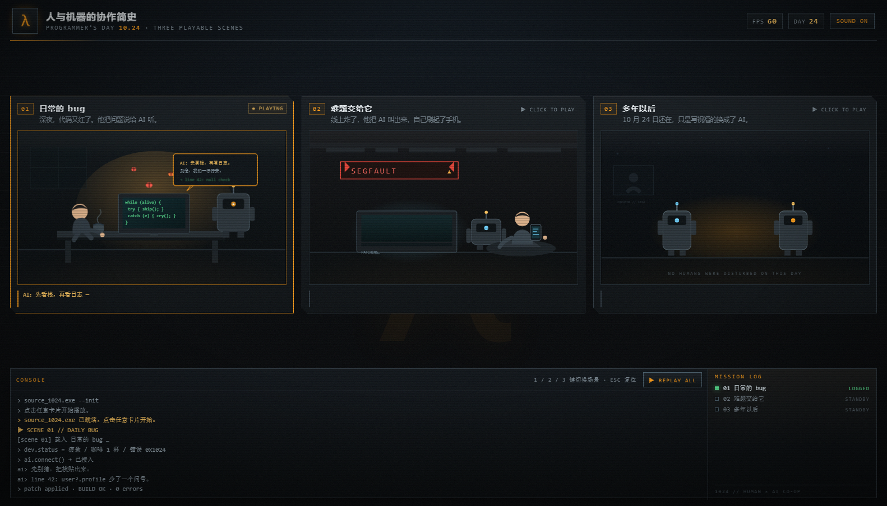

# 1024 // 人与机器的协作简史

1024 程序员节的单页互动小剧场：三幕可点击播放的动画，讲人类程序员和 AI 之间的合作。
视觉走**初代 Source 引擎（2004，半条命 2 那个年代）**的路子：暗金属面板、HUD 橙、CRT 扫描线、
等宽控制台、切角面板和 λ。



## 三幕

| # | 场景 | 内容 |
| --- | --- | --- |
| 01 | **日常的 bug** | 深夜代码飘红，他把问题讲给 AI；AI 入场、指出第 42 行的空指针，红色 ERROR 熄灭，面板变成 `BUILD OK`。 |
| 02 | **难题交给它** | 线上 `SEGFAULT`，他把终端交给 AI；AI 双臂忙着重跑 bisect，进度条推进，他在旁边瘫着刷手机，最后 `DEPLOYED ✔` 盖章。 |
| 03 | **多年以后** | 2049 年 10 月 24 日，机房里两个 AI 互道祝福：一张写着 `10.24` 的卡片浮起，信号环扩散，屏幕上打出「你们写过的每个 if，我们都还留着」。 |

每张卡片**点击即播放**，再次点击重播；三张卡片互斥（播一个，其余复位）。

## 交互

- 点击卡片 / `Enter` / `空格`：播放对应场景（重播同样操作）
- 键盘 `1` `2` `3`：切换场景；`Esc`：全部复位
- `REPLAY ALL`：按顺序连播三幕
- `SOUND ON/OFF`：开关 WebAudio 合成的提示音（无音频文件）
- 底部 `CONSOLE` 同步输出旁白日志；右侧 `MISSION LOG` 会点亮已看过的场景
- 开场有一段 `SOURCE//1024` 自检动画，点击或回车可跳过
- 支持 `prefers-reduced-motion`，移动端自动单列

## 技术

纯静态三件套，无构建、无依赖：

```
programmer-day-1024/
├─ index.html   结构 + 三段内联 SVG 分镜
├─ styles.css   Source 风格主题、CRT 特效、所有关键帧动画
└─ app.js       播放调度、打字机、控制台日志、合成音效、FPS 装饰
```

动画全部由 CSS keyframes 驱动，靠 `.chapter.is-playing` 前缀触发；JS 只负责切类、重排重播、
写日志和管音效。所以即使关掉 JS 的动画调度，SVG 本身也是完整可读的分镜。

## 运行

```powershell
cd programmer-day-1024
python -m http.server 7810
# 打开 http://127.0.0.1:7810
```

也可以直接双击 `index.html`（脚本是普通 `defer`，不依赖模块加载）。

## 视觉参照

- 面板：切角（clip-path）、内阴影、1px 冷灰描边、橙色只用在状态和强调上
- 字体：界面 Verdana/Tahoma，数据与控制台 Consolas
- 全屏叠加：扫描线、颗粒噪点（SVG feTurbulence）、暗角、背景大 λ 水印
- 分镜：低饱和暗色房间 + 局部橙色灯光，机器人和人都是简单几何体，靠动作和光效讲故事
